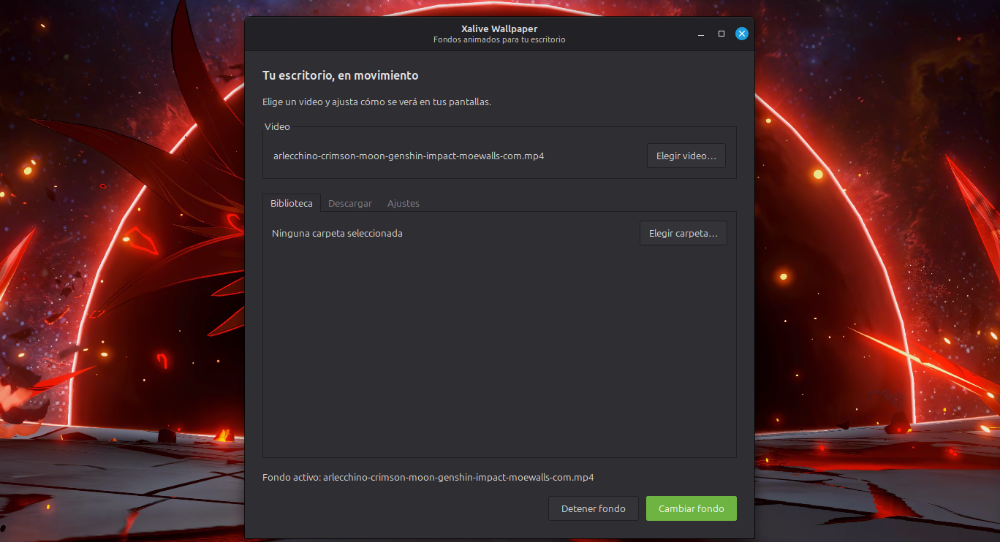
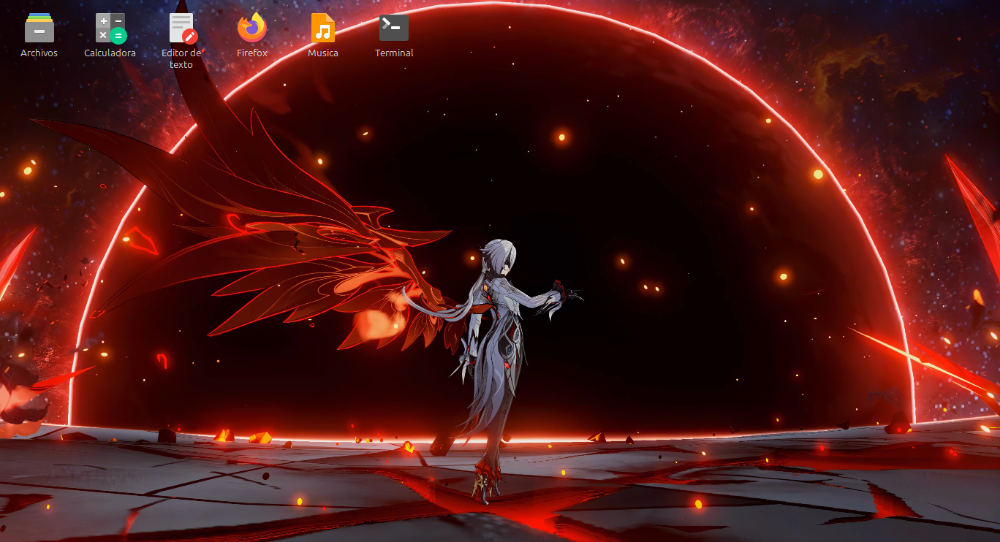
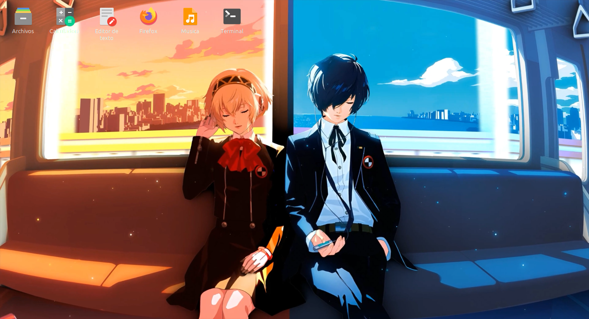

# Xalive Wallpaper

A small, native Linux live-wallpaper app for X11 desktops such as XFCE.
It uses GTK 3 to create windows stacked just above the desktop and embeds
[mpv](https://mpv.io/) for video playback. It does not require Flatpak.

> **Note:** this project was made with AI assistance (GitHub Copilot). It
> started as a personal experiment: I didn't want to use Hidamari or other
> existing programs, so I asked an AI to build one. It is provided as-is and may
> contain bugs. If you find one, feel free to fix it: the whole app lives in
> [`xalive.py`](xalive.py) (the wallpaper catalogs are in `xalive_sources.py`),
> and pull requests are welcome.

## Screenshots







The desktop icons shown are sample launchers, not real ones. The wallpapers are
third-party artwork used only to demonstrate the app; they are not included in
this repository.

## Performance

Measured over 40 seconds of playback, with the wallpaper visible, on a laptop
with an Intel Core 3 100U (8 threads), 7.6 GB of RAM, mpv 0.37.0 and VAAPI
hardware decoding. The screen was 1368x768.

| Video | Format | Size | CPU (one core = 100 %) | RAM |
|-------|--------|------|------------------------|-----|
| Arlecchino (moewalls) | H.264, 3840x2160, 60 fps | 78 MB | 13.2 % (mpv 11.7 % + app 1.6 %) | 267 MB |
| Train | H.264, 3840x2160, 60 fps | 65 MB | 14.0 % (mpv 12.3 % + app 1.7 %) | 258 MB |

That is about 1.7 % of the total CPU of the machine while playing 4K at 60 fps.
Without hardware decoding the load is much higher, so make sure your VAAPI
driver works (`vainfo`). When another application is maximized, playback pauses
and the CPU use drops to almost zero.

This is an early prototype. Desktop window stacking differs between window
managers, so the result needs testing on the target desktop; XFCE is the first
target.

## Requirements

On Linux Mint, install the system packages:

```sh
sudo apt install mpv python3-gi gir1.2-gtk-3.0 wmctrl
```

Install it for your user (no root, no terminal needed afterwards):

```sh
./install.sh            # adds "Xalive Wallpaper" to the applications menu
./install.sh --remove   # uninstalls (settings are kept)
```

In **Settings**, turn on **Initial session** to start it with XFCE
(an XDG autostart entry, no extra tools) and **Recordar el último fondo al
abrir** to re-apply the last wallpaper, fit and audio choice automatically.
When started by the session it stays hidden and waits for xfdesktop and the
compositor if they are not ready yet. Closing the window while a wallpaper is
active keeps it running in the background; open the program again to bring the
window back. Use **Detener fondo** and then close the window to quit.

Playback uses mpv hardware decoding (`--hwdec=auto-safe`, VA-API on Intel/AMD)
with its `fast` profile; it falls back to software decoding if no GPU decoder
is available (much higher CPU on 4K videos). Window state is only polled once
per second while "Pausar con ventanas maximizadas" is on.

Or run the graphical interface directly from an X11 session:

```sh
python3 xalive.py
```

Choose a video, select how it fits the screen, and optionally enable audio.
Click **Apply wallpaper** to start playback or **Stop wallpaper** to restore
the desktop. Closing the control window also stops playback. The icon-size
slider ranges from 24 to 128 pixels and updates the desktop icons immediately.
The **Download** tab has two views:

- **Explore** is a native gallery (thumbnail, title, resolution) for MoeWalls,
  MotionBGs and Internet Archive, with search and "load more". **Download**
  saves the original file unmodified into the library folder, with progress and
  a cancel button, and it then appears in the Library. MotionBGs and Internet
  Archive are fetched directly; MoeWalls only reveals its file link through its
  own download button, so a hidden, ad-blocked browser view presses it for you.
- **Browser** embeds WebKitGTK (loaded on demand;
  `sudo apt install gir1.2-webkit2-4.1`) with shortcuts to MoeWalls,
  MyLiveWallpapers, MotionBGs, Pixabay and Internet Archive, for anything the
  gallery does not cover.

Both use the same protection: a built-in list of ad and pop-under networks is
blocked, pop-ups are refused, and pages that try to redirect you to another site
without you clicking are stopped. The catalog code lives in `xalive_sources.py`
(keep it next to `xalive.py`); sites may change their HTML, which would
require updating it. MyLiveWallpapers sits behind an anti-bot check, so it is
browser-only. Respect each site's terms and the wallpapers' licenses.
The **Library** tab lets you pick a folder of videos and shows a thumbnail of
each one (cached in `~/.cache/xalive/thumbs`); click one to select it.
The **Pause with maximized or fullscreen windows** switch (on by default)
pauses the video, using mpv's IPC, while a maximized or fullscreen window is
visible on the current workspace; floating windows leave it playing.
Applications listed under **Exceptions** (by
window class, e.g. `vlc`) never pause it, which suits apps that
use transparency.
Drag icons to snap them to a compact grid based on the selected icon size.
Names are always shown in full, wrapping onto as many lines as needed; rows
are sized to fit the longest name and occupied cells are skipped. Their size and positions are saved in
`~/.config/xalive/settings.json` (or `$XDG_CONFIG_HOME` when set; settings from the
old `livewallpaper` folder are copied on first run).

The wallpaper adapts on its own to each monitor: if the screen resolution
changes or a monitor is plugged in or removed, the video and icon layer are
rebuilt to match. Mirrored monitors share a single player. The **Monitores**
section of the Settings tab lists every connected monitor with its available
resolutions (`xrandr` modes) and a video picker, so each monitor can play its
own wallpaper (monitors without one use the main video; mirrored monitors
share one player, and only the first player has sound). Choosing a resolution applies it with a
10-second confirmation that reverts automatically, and is restored on the next start.
"Automática" leaves the resolution to the system. A lower resolution also
reduces GPU load.

The command-line mode is still available by passing a video path:

```sh
python3 xalive.py "/path/to/video.mp4"
```

That mode runs in the foreground. Press `Ctrl+C` in its terminal to stop it.
Playback is muted by default; `--audio` enables audio. Videos fill each
monitor and are cropped by default; pass `--fit contain` to preserve the whole
frame (letterboxing may appear).

When `xfdesktop` is running, the program temporarily hides its native desktop
icons and draws a lightweight replacement layer above the video. It shows
files, folders, and launchers from the XDG Desktop folder, supports opening
them with a double-click, and restores the previous XFCE icon setting when the
program exits. Launchers use their configured icon and display name rather
than the `.desktop` filename. Names are shown in full, wrapped across lines.
Icons are arranged in a grid sized to the selected icon and snap to free cells when dragged. Their positions are saved between runs.
The
transparent icon layer is stacked above the video and below normal application
windows. The video itself sits above XFCE's static background. Both are
non-focusable, sticky X11 normal windows, explicitly stacked above XFCE's
opaque desktop window.
Stop it normally with `Ctrl+C` or a session signal so the original XFCE icon
setting is restored; a forced kill (`SIGKILL`) cannot run cleanup.

For XFCE autostart, open **Session and Startup → Application Autostart** and
add a command such as:

```sh
python3 "/path/to/xalive.py" "/path/to/video.mp4"
```

To stop an autostarted instance, end its `xalive.py` process from XFCE's
session controls or a terminal.

## Current scope

- X11 only; Wayland is not supported yet.
- Starts one mpv process per detected monitor.
- The replacement icon layer covers the X11 screen; icon positions snap to a
  size-dependent grid.
- Window-minimize icons, removable-device icons, and XFCE's full desktop
  context menu are not included.
- The graphical interface provides video selection, fit mode, audio, icon size,
  and start/stop controls; it does not yet include a video preview or playlist.
- Transparent icons require the XFCE compositor to be enabled.

## License

Released under the [PolyForm Noncommercial License 1.0.0](LICENSE.md): you can
use, modify and share the code for any non-commercial purpose, but you may not
use it to make money. Note that this is a source-available license, not an
OSI-approved open-source one.
